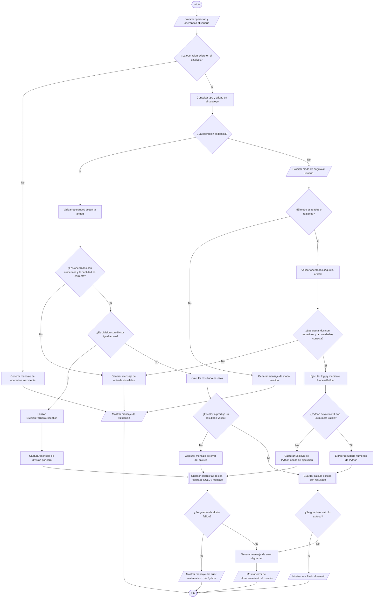

# Flujograma 1: Operación completa

**Proyecto:** Calculadora Java, Python y SQLite  

Este flujograma representa el proceso de ejecución de operaciones matemáticas, validación de datos, manejo de errores y almacenamiento de los resultados en la base de datos.

