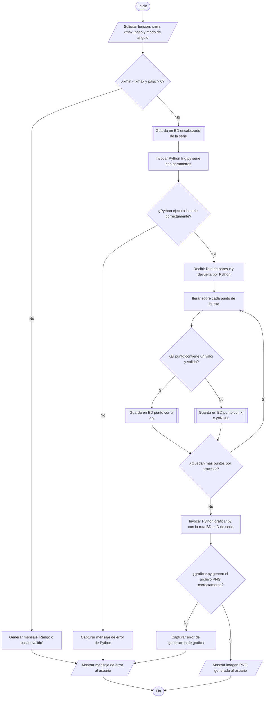

# Flujograma 2: Generación de puntos y gráfica

Este flujograma describe la validación de rangos, generación de puntos mediante Python, almacenamiento en SQLite y creación de gráficas en formato PNG.

