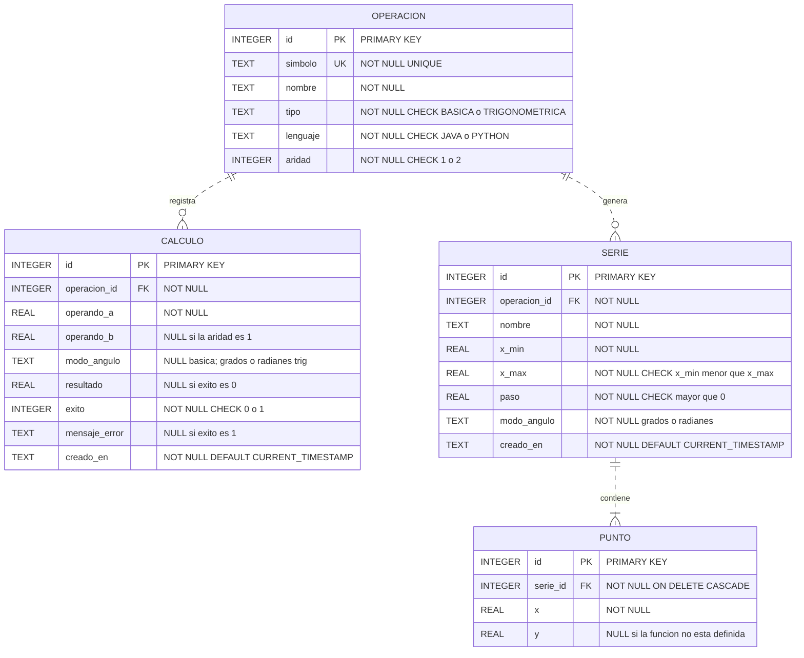

# Diagrama Entidad-Relación (E-R)

**Proyecto:** Calculadora Java, Python y SQLite  

Este diagrama representa las entidades, atributos, claves primarias (PK), claves foráneas (FK), restricciones y cardinalidades del sistema.

