# Diagrama de Clases UML

**Proyecto:** Calculadora Java, Python y SQLite  

Este diagrama representa la arquitectura orientada a objetos de la calculadora, incluyendo interfaces, clases abstractas, herencia, polimorfismo, atributos, métodos, excepciones y asociaciones.

```mermaid
classDiagram
    direction TB

    %% Se muestran las firmas relevantes; se omiten getters/setters repetitivos de DTO.
    %% Cada DTO conserva todos los atributos de su entidad de SQLite.

    %% CONTRATO DE OPERACIONES Y POLIMORFISMO
    class Operacion {
        <<interface>>
        +getSimbolo() String
        +getNombre() String
        +getAridad() int
        +calcular(operandos: double[]) double
    }
    class OperacionBasica {
        <<abstract>>
        #simbolo: String
        #nombre: String
        #aridad: int
        +getSimbolo() String
        +getNombre() String
        +getAridad() int
        +calcular(operandos: double[]) double*
    }
    class Suma {
        +calcular(operandos: double[]) double
    }
    class Resta {
        +calcular(operandos: double[]) double
    }
    class Multiplicacion {
        +calcular(operandos: double[]) double
    }
    class Division {
        +calcular(operandos: double[]) double
    }
    class OperacionTrigonometrica {
        -simbolo: String
        -nombre: String
        -modoAngulo: String
        -pythonBridge: PythonBridge
        +getSimbolo() String
        +getNombre() String
        +getAridad() int
        +setModoAngulo(modo: String) void
        +calcular(operandos: double[]) double
    }
    class PythonBridge {
        -pythonExecutable: String
        -scriptTrigPath: String
        -scriptGraficarPath: String
        +ejecutarTrig(funcion: String, valor: double, modo: String) String
        +ejecutarSerie(funcion: String, xmin: double, xmax: double, paso: double, modo: String) List~String~
        +ejecutarGrafica(dbPath: String, serieId: int, salidaPNG: String) boolean
    }

    %% DTO: DATOS CON LOS MISMOS CAMPOS DEL MODELO ER
    class OperacionDTO {
        -id: Integer
        -simbolo: String
        -nombre: String
        -tipo: String
        -lenguaje: String
        -aridad: int
        +getSimbolo() String
        +getAridad() int
    }
    class CalculoDTO {
        -id: Integer
        -operacionId: int
        -operandoA: double
        -operandoB: Double
        -modoAngulo: String
        -resultado: Double
        -exito: boolean
        -mensajeError: String
        -creadoEn: LocalDateTime
        -guardado: boolean
        +getResultado() Double
        +isExito() boolean
        +isGuardado() boolean
        +getMensajeError() String
    }
    class SerieDTO {
        -id: Integer
        -operacionId: int
        -nombre: String
        -xMin: double
        -xMax: double
        -paso: double
        -modoAngulo: String
        -creadoEn: LocalDateTime
        +getId() Integer
        +setId(id: int) void
    }
    class PuntoDTO {
        -id: Integer
        -serieId: Integer
        -x: double
        -y: Double
        +PuntoDTO(x: double, y: Double)
        +setSerieId(serieId: int) void
        +getY() Double
    }

    %% DAO: CONSULTAS Y PERSISTENCIA CON JDBC
    class OperacionDAO {
        -dbUrl: String
        +buscarPorSimbolo(simbolo: String) OperacionDTO
        +listarOperaciones() List~OperacionDTO~
    }
    class CalculoDAO {
        -dbUrl: String
        +guardarCalculo(calculo: CalculoDTO) int
        +obtenerHistorial(operacionId: Integer, exito: Boolean) List~CalculoDTO~
    }
    class SerieDAO {
        -dbUrl: String
        +guardarSerieConPuntos(serie: SerieDTO, puntos: List~PuntoDTO~) int
        +obtenerPuntos(serieId: int) List~PuntoDTO~
    }

    %% SERVICIOS: REGLAS DEL NEGOCIO
    class CalculadoraService {
        -operaciones: Map~String,Operacion~
        -operacionDAO: OperacionDAO
        -calculoDAO: CalculoDAO
        +registrarOperacion(operacion: Operacion) void
        +validarOperandos(entradas: String[], aridad: int) double[]
        +ejecutarOperacion(simbolo: String, entradas: String[], modo: String) CalculoDTO
        +consultarHistorial(operacionId: Integer, exito: Boolean) List~CalculoDTO~
    }
    class SerieService {
        -operacionDAO: OperacionDAO
        -serieDAO: SerieDAO
        -pythonBridge: PythonBridge
        -dbPath: String
        +validarParametros(funcion: String, xmin: double, xmax: double, paso: double, modo: String) boolean
        +convertirPuntos(lineas: List~String~) List~PuntoDTO~
        +generarSerie(funcion: String, nombre: String, xmin: double, xmax: double, paso: double, modo: String) int
        +tienePuntosIndefinidos(serieId: int) boolean
        +generarGrafica(serieId: int, salidaPNG: String) boolean
    }
    class CalculadoraUI {
        -calculadoraService: CalculadoraService
        -serieService: SerieService
        +solicitarOperacion() String
        +solicitarOperandos() String[]
        +solicitarModoAngulo() String
        +solicitarDatosSerie() SerieDTO
        +mostrarResultado(resultado: double) void
        +mostrarError(mensaje: String) void
        +mostrarAdvertencia(mensaje: String) void
        +mostrarGrafica(rutaPNG: String) void
    }

    %% EXCEPCIONES PROPIAS
    class CalculadoraException {
        +CalculadoraException(mensaje: String)
    }
    class DivisionPorCeroException {
        +DivisionPorCeroException(mensaje: String)
    }
    class OperacionTrigonometricaException {
        +OperacionTrigonometricaException(mensaje: String)
    }
    class ValidacionException {
        +ValidacionException(mensaje: String)
    }
    class PythonEjecucionException {
        +PythonEjecucionException(mensaje: String)
    }

    %% IMPLEMENTACION DE INTERFAZ Y HERENCIA
    Operacion <|.. OperacionBasica
    Operacion <|.. OperacionTrigonometrica
    OperacionBasica <|-- Suma
    OperacionBasica <|-- Resta
    OperacionBasica <|-- Multiplicacion
    OperacionBasica <|-- Division
    CalculadoraException <|-- DivisionPorCeroException
    CalculadoraException <|-- OperacionTrigonometricaException
    CalculadoraException <|-- ValidacionException
    CalculadoraException <|-- PythonEjecucionException

    %% ASOCIACIONES CON MULTIPLICIDAD UML
    CalculadoraUI "1" --> "1" CalculadoraService : utiliza
    CalculadoraUI "1" --> "1" SerieService : utiliza
    CalculadoraService "1" --> "0..*" Operacion : gestiona
    CalculadoraService "1" --> "1" OperacionDAO : consulta
    CalculadoraService "1" --> "1" CalculoDAO : guarda
    SerieService "1" --> "1" OperacionDAO : consulta
    SerieService "1" --> "1" SerieDAO : guarda
    SerieService "1" --> "1" PythonBridge : invoca
    OperacionTrigonometrica "0..*" --> "1" PythonBridge : invoca

    %% DEPENDENCIAS DE ERROR Y DE DATOS
    Division ..> DivisionPorCeroException : lanza
    CalculadoraService ..> ValidacionException : lanza
    SerieService ..> ValidacionException : lanza
    PythonBridge ..> PythonEjecucionException : lanza

    %% CARDINALIDADES LOGICAS DE LAS FK, NO REFERENCIAS DIRECTAS ENTRE OBJETOS
    OperacionDTO "1" --> "0..*" CalculoDTO : FK operacionId
    OperacionDTO "1" --> "0..*" SerieDTO : FK operacionId
    SerieDTO "1" --> "1..*" PuntoDTO : FK serieId

    %% CalculoDTO.guardado es estado temporal de la aplicacion, NO columna SQL.
    %% PuntoDTO.serieId se asigna al persistir, despues de crear SERIE.
    %% SerieDAO usa una transaccion: COMMIT o ROLLBACK para serie y puntos.
    %% CalculoDAO configura busy_timeout en la conexion JDBC.
    %% El historial admite filtros nulos y orden cronologico.
    %% Las excepciones propias extienden CalculadoraException (RuntimeException).
```

